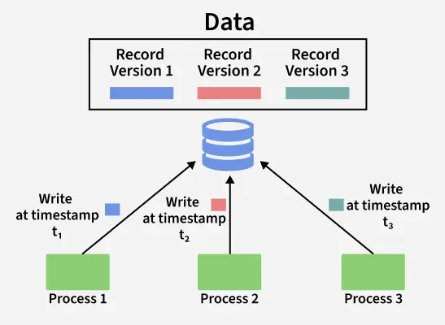

# Database Isolation Levels

## Introduction

Database Isolation is one of the four properties of ACID transactions.

It controls how multiple transactions interact with each other when executing simultaneously.

When multiple transactions access or modify the same data, problems can occur if their operations interfere with each other.

**Isolation Levels define how much one transaction is allowed to see the changes made by another transaction.**

Higher isolation generally provides better consistency but may reduce concurrency.

### Example

Suppose we have a bank account with a balance of ₹10,000.

Two transactions execute simultaneously:

- T1 reads the account balance.
- T2 updates the balance to ₹8,000.

Depending on the isolation level, T1 may or may not see the updated balance.

---

##  Sample Dataset

We will use the following table throughout this paper.

### bank_accounts

| account_id | account_holder | balance |
|---|---|---:|
| 101 | Alice | 10000 |
| 102 | Bob | 15000 |
| 103 | Charlie | 20000 |

### SQL

```sql
CREATE TABLE bank_accounts (
    account_id INT PRIMARY KEY,
    account_holder VARCHAR(50),
    balance INT
);

INSERT INTO bank_accounts VALUES
(101, 'Alice', 10000),
(102, 'Bob', 15000),
(103, 'Charlie', 20000);
```

---

##  Concurrency Problems

When multiple transactions execute simultaneously, the following problems can occur.

### 1. Dirty Read

A Dirty Read occurs when one transaction reads data modified by another transaction that has not yet committed.

**Example:**

Two transactions execute simultaneously.

```text
Transaction T1:
1. BEGIN
2. UPDATE bank_accounts
   SET balance = 8000
   WHERE account_id = 101
3. COMMIT

Transaction T2:
1. BEGIN
2. SELECT balance
   FROM bank_accounts
   WHERE account_id = 101
```

Suppose T2 reads the balance before T1 commits.

It may read ₹8,000 even though T1 has not committed yet.

If T1 later performs ROLLBACK, the balance returns to ₹10,000.

T2 has read a value that was never permanently saved.

**Important:** PostgreSQL does not allow dirty reads, even at its Read Uncommitted isolation level.

### 2. Non-Repeatable Read

A Non-Repeatable Read occurs when a transaction reads the same row twice but gets different values because another transaction modified and committed that row between the reads.

**Example:**

```text
Transaction T1:
1. BEGIN
2. SELECT balance FROM bank_accounts
   WHERE account_id = 101;
   Output: 10000

3. SELECT balance FROM bank_accounts
   WHERE account_id = 101;
   Output: 8000

Transaction T2:
1. BEGIN
2. UPDATE bank_accounts
   SET balance = 8000
   WHERE account_id = 101;
3. COMMIT
```

T1 reads ₹10,000 initially and ₹8,000 later.

The same query returns different values within the same transaction.

### 3. Phantom Read

A Phantom Read occurs when a transaction executes the same query twice but gets a different set of rows because another transaction inserted, deleted, or modified rows that satisfy the query condition.

**Example:**

Initially, Alice and Bob have balances greater than ₹10,000.

```text
Transaction T1:
1. BEGIN

2. SELECT * FROM bank_accounts
   WHERE balance > 10000;

   Output: Bob, Charlie

3. SELECT * FROM bank_accounts
   WHERE balance > 10000;

   Output: Bob, Charlie, David
```

Meanwhile:

```text
Transaction T2:
1. BEGIN
2. INSERT INTO bank_accounts
   VALUES (104, 'David', 12000);
3. COMMIT
```

T1 gets an additional row when executing the same query again.

That additional row is called a phantom row.

### 4. Lost Update

A Lost Update occurs when two transactions read the same original value, modify it independently, and one transaction overwrites the changes made by the other.

**Example:**

Initial balance = ₹10,000.

```text
Transaction T1:
1. Reads balance = 10000
2. Calculates 10000 - 2000 = 8000

Transaction T2:
1. Reads balance = 10000
2. Calculates 10000 - 3000 = 7000

T1 updates balance = 8000
T2 updates balance = 7000
```

Final balance = ₹7,000.

The update made by T1 is lost.

The correct balance should have been ₹5,000.

**Note:** Lost updates can be prevented using appropriate locking, atomic SQL updates, or transaction isolation mechanisms.

---

##  Database Isolation Levels

Isolation levels define the degree of isolation between concurrent transactions.

There are four standard SQL isolation levels.

### 1. Read Uncommitted

This is the lowest isolation level.

- A transaction may read uncommitted changes made by another transaction.
- Dirty reads, non-repeatable reads, and phantom reads are permitted by the SQL standard.

**Example:**

```sql
BEGIN TRANSACTION ISOLATION LEVEL READ UNCOMMITTED;

SELECT balance
FROM bank_accounts
WHERE account_id = 101;

COMMIT;
```

**Important:** PostgreSQL treats Read Uncommitted as Read Committed because it does not support dirty reads.

### 2. Read Committed

This isolation level ensures that a transaction only reads committed data.

- Dirty reads are prevented.
- Non-repeatable reads are possible.
- Phantom reads are possible.

**Example:**

```sql
BEGIN TRANSACTION ISOLATION LEVEL READ COMMITTED;

SELECT balance
FROM bank_accounts
WHERE account_id = 101;

COMMIT;
```

If another transaction updates and commits the balance between two SELECT statements, the next SELECT can return the updated value.

**PostgreSQL Default:** Read Committed is the default isolation level in PostgreSQL.

### 3. Repeatable Read

This isolation level ensures that repeated reads of the same rows return consistent values within a transaction.

- Dirty reads are prevented.
- Non-repeatable reads are prevented.
- Phantom reads are permitted by the SQL standard.

**Example:**

```sql
BEGIN TRANSACTION ISOLATION LEVEL REPEATABLE READ;

SELECT balance
FROM bank_accounts
WHERE account_id = 101;

COMMIT;
```

Even if another transaction updates and commits the balance, the current transaction continues seeing its original snapshot.

**PostgreSQL Note:** PostgreSQL's Repeatable Read implementation also prevents phantom reads through snapshot isolation. However, serialization anomalies can still occur.

### 4. Serializable

This is the highest standard isolation level.

It ensures that concurrent transactions produce results equivalent to some serial execution order.

In simple words, the database behaves as if transactions had executed one after another.

- Dirty reads are prevented.
- Non-repeatable reads are prevented.
- Phantom reads are prevented.
- Serialization anomalies are prevented.

**Example:**

```sql
BEGIN TRANSACTION ISOLATION LEVEL SERIALIZABLE;

SELECT balance
FROM bank_accounts
WHERE account_id = 101;

COMMIT;
```

If concurrent transactions create a situation that cannot be safely serialized, the database may abort one transaction.

**Important:** Applications must handle serialization failures and retry the affected transaction when appropriate.

---

## Comparison of Isolation Levels

| Isolation Level | Dirty Read | Non-Repeatable Read | Phantom Read |
|---|---|---|---|
| Read Uncommitted | Possible | Possible | Possible |
| Read Committed | Prevented | Possible | Possible |
| Repeatable Read | Prevented | Prevented | Possible |
| Serializable | Prevented | Prevented | Prevented |

**Note:** This table represents the guarantees defined by the SQL standard. Individual database implementations may provide stronger guarantees.

---

##  Isolation Levels in PostgreSQL

PostgreSQL supports all four standard isolation level names, but their actual behavior differs slightly from the SQL standard.

| Isolation Level | PostgreSQL Behavior |
|---|---|
| Read Uncommitted | Behaves like Read Committed |
| Read Committed | Each statement gets a new snapshot |
| Repeatable Read | All statements use the same transaction snapshot |
| Serializable | Uses Serializable Snapshot Isolation (SSI) |

### How to Set Isolation Level

**Method 1: While Starting a Transaction**

```sql
BEGIN TRANSACTION ISOLATION LEVEL SERIALIZABLE;

SELECT * FROM bank_accounts;

COMMIT;
```

**Method 2: Using SET TRANSACTION**

```sql
BEGIN;

SET TRANSACTION ISOLATION LEVEL REPEATABLE READ;

SELECT * FROM bank_accounts;

COMMIT;
```

**Method 3: Check Current Isolation Level**

```sql
SHOW transaction_isolation;
```

**Output:**

```text
transaction_isolation
----------------------
read committed
```

### Changing Default Isolation Level

```sql
SET default_transaction_isolation = 'serializable';
```

This changes the default for the current database session.

---

##  Isolation vs Locking

Isolation and locking are related but different concepts.

| Isolation | Locking |
|---|---|
| Defines how transactions interact with each other | Controls access to database resources |
| Prevents concurrency-related anomalies | Prevents conflicting operations |
| Can use snapshots or locks | Uses shared and exclusive locks, among others |
| Configured using isolation levels | Acquired automatically or explicitly |

**Example:**

- Isolation determines what data a transaction can see.
- Locking determines whether another transaction can modify a particular resource immediately or must wait.

PostgreSQL uses MVCC (Multi-Version Concurrency Control) along with locks to implement transaction isolation.

---

##  MVCC (Multi-Version Concurrency Control)

MVCC is a database technique that maintains multiple versions of a row instead of immediately replacing the old version.

It allows transactions to read a consistent snapshot of data while other transactions modify it.

### Example

Suppose Alice's balance is ₹10,000.

Transaction T1 reads the balance.

Meanwhile, T2 updates it to ₹8,000 and commits.

Under PostgreSQL's MVCC:

- T1 can continue reading the older version according to its snapshot.
- New transactions can see the updated balance.
- The database manages old row versions and removes obsolete versions when they are no longer needed.

### Diagram



### Advantages of MVCC

1. Readers generally do not block writers.
2. Writers generally do not block ordinary readers.
3. Provides consistent snapshots.
4. Improves concurrency.
5. Helps implement transaction isolation efficiently.

**Note:** MVCC does not eliminate all locking. Updates, deletes, explicit row locks, and certain table operations can still block other transactions.

---

##  How to Choose an Isolation Level

| Isolation Level | Suitable Use Case |
|---|---|
| Read Uncommitted | Applications where weaker isolation is acceptable; PostgreSQL treats it as Read Committed |
| Read Committed | General-purpose applications |
| Repeatable Read | Applications requiring consistent reads throughout a transaction |
| Serializable | Critical operations requiring serializable execution |
