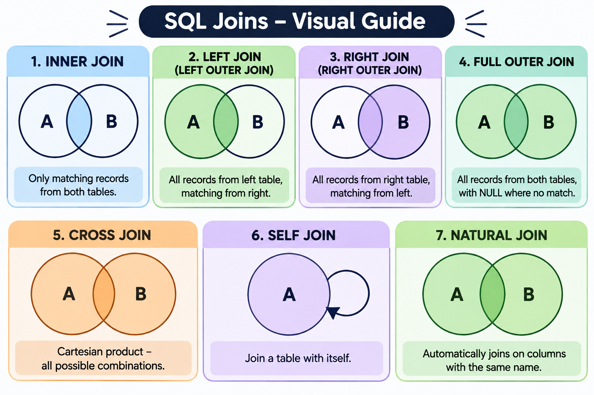

# SQL Joins

##  What is a JOIN?

A `JOIN` in SQL is used to combine data from two or more tables based on a related column.

##  Why Do We Need JOINs?

We use JOIN to retrieve related data from multiple tables based on a common column.

Instead of storing all information in one large table, databases store related information in separate tables to avoid data duplication.


##  Types of JOINs

The major types of SQL joins are:

1. INNER JOIN
2. LEFT JOIN (LEFT OUTER JOIN)
3. RIGHT JOIN (RIGHT OUTER JOIN)
4. FULL OUTER JOIN
5. CROSS JOIN
6. SELF JOIN


---

## Sample Tables Used 

### employees

| id | name | department_id |
|---:|---|---:|
| 1 | Asha | 10 |
| 2 | Ravi | 10 |
| 3 | Meera | 20 |
| 4 | Kabir | NULL |

### departments

| id | name |
|---:|---|
| 10 | Engineering |
| 20 | Sales |
| 30 | HR |

`Kabir` has no department assigned (`department_id` is `NULL`). The HR department has no employees. These unmatched records help explain the differences between JOIN types.

---

##  INNER JOIN

`INNER JOIN` returns only the records that have matching values in both tables.

### Example

```sql
SELECT
    e.name,
    d.name AS department_name
FROM employees e
INNER JOIN departments d
    ON e.department_id = d.id;
```

### Output

| name | department_name |
|---|---|
| Asha | Engineering |
| Ravi | Engineering |
| Meera | Sales |

**Explanation:**

- Asha and Ravi match department ID `10`.
- Meera matches department ID `20`.
- Kabir is excluded because his `department_id` is `NULL`.
- HR is excluded because no employee belongs to department ID `30`.

### When to Use INNER JOIN?

Use `INNER JOIN` when you only need records that have matching values in both tables.

---

##  LEFT JOIN (LEFT OUTER JOIN)

`LEFT JOIN` returns:

- All records from the left table.
- Matching records from the right table.
- `NULL` for right-table columns when no match exists.

### Example

```sql
SELECT
    e.name,
    d.name AS department_name
FROM employees e
LEFT JOIN departments d
    ON e.department_id = d.id;
```

### Output

| name | department_name |
|---|---|
| Asha | Engineering |
| Ravi | Engineering |
| Meera | Sales |
| Kabir | NULL |

**Explanation:**

Every row from the left table (`employees`) is returned. Kabir is included even though he has no matching department. HR is excluded because LEFT JOIN preserves all rows from the left table, not the right table.

###  LEFT JOIN with Unmatched Records

We can use `LEFT JOIN` with `WHERE right_table.key IS NULL` to find records in the left table that have no matching record in the right table.

### Example: Find employees without a department

```sql
SELECT e.name
FROM employees e
LEFT JOIN departments d
    ON e.department_id = d.id
WHERE d.id IS NULL;
```

### Output

| name |
|---|
| Kabir |

This pattern is commonly called an **anti-join**. It is useful when we want to find records that do not have a corresponding match.

### When to Use LEFT JOIN?

- When all employees must be displayed, including those without a department.
- When we need to find employees who do not have a matching department.

---

##  RIGHT JOIN (RIGHT OUTER JOIN)

`RIGHT JOIN` returns:

- All records from the right table.
- Matching records from the left table.
- `NULL` for left-table columns when no match exists.

### Example

```sql
SELECT
    e.name,
    d.name AS department_name
FROM employees e
RIGHT JOIN departments d
    ON e.department_id = d.id;
```

### Output

| name | department_name |
|---|---|
| Asha | Engineering |
| Ravi | Engineering |
| Meera | Sales |
| NULL | HR |

**Explanation:**

Every row from the right table (`departments`) is returned. HR is included even though no employee belongs to it. Kabir is excluded because RIGHT JOIN preserves all rows from the right table, not the left table.

### When to Use RIGHT JOIN?

Use `RIGHT JOIN` when you want every record from the right table, regardless of whether a matching record exists in the left table.

---

##  FULL OUTER JOIN

`FULL OUTER JOIN` returns:

- All matching records.
- All unmatched records from the left table.
- All unmatched records from the right table.

For unmatched records, columns from the opposite table contain `NULL`.

### Example

```sql
SELECT
    e.name,
    d.name AS department_name
FROM employees e
FULL OUTER JOIN departments d
    ON e.department_id = d.id;
```

### Output

| name | department_name |
|---|---|
| Asha | Engineering |
| Ravi | Engineering |
| Meera | Sales |
| Kabir | NULL |
| NULL | HR |

**Explanation:**

- Matching employee and department records are returned.
- Kabir is included even though he has no department.
- HR is included even though it has no employees.

### When to Use FULL OUTER JOIN?

- To compare two tables.
- To identify matching and unmatched records.
- To preserve all records from both tables.

---

##  CROSS JOIN

`CROSS JOIN` returns the Cartesian product of two tables.

It combines every row from the first table with every row from the second table.

### Example

```sql
SELECT
    e.name,
    d.name AS department_name
FROM employees e
CROSS JOIN departments d;
```

The `employees` table has 4 rows, and the `departments` table has 3 rows.

**Total output rows = 4 × 3 = 12**

Each employee is paired with every department, whether or not that department is assigned to the employee.

### How Many Rows Will CROSS JOIN Produce?

If:

- The first table has M rows.
- The second table has N rows.

Then:

**Total output rows = M × N**

### Important Points

- CROSS JOIN does not require an `ON` condition.
- It generates every possible combination of rows.
- Be careful when using it with large tables because the output can become very large.

---

##  SELF JOIN

A `SELF JOIN` is a join in which a table is joined with itself.

It is useful when records within the same table are related to one another. We use aliases to refer to the same table separately.

### Example: Find pairs of employees working in the same department

```sql
SELECT
    e1.name AS employee1,
    e2.name AS employee2,
    e1.department_id
FROM employees e1
JOIN employees e2
    ON e1.department_id = e2.department_id
   AND e1.id < e2.id;
```

### Output

| employee1 | employee2 | department_id |
|---|---|---:|
| Asha | Ravi | 10 |

**Explanation:**

- `e1` and `e2` are two aliases for the same `employees` table.
- The department IDs must match.
- `e1.id < e2.id` avoids pairing an employee with themselves and avoids duplicate reversed pairs.
- Meera has no other employee in department `20`.
- Kabir is not matched because `NULL` does not equal `NULL`.

### When to Use SELF JOIN?

- To compare records within the same table.
- To find records that share a common value.
- To represent hierarchical relationships, such as employee-manager relationships, when the table stores the manager ID.

---

##  Joining More Than Two Tables

SQL allows us to join more than two tables in a single query. Each additional table is joined using a related column or condition.

### General Syntax

```sql
SELECT columns
FROM table1
JOIN table2
    ON table1.common_column = table2.common_column
JOIN table3
    ON table2.another_column = table3.another_column;
```

---

##  Multiple JOIN Conditions

Sometimes, matching records requires more than one condition. We can use `AND` or `OR` in the `ON` clause.

### Example: Match employees to the Engineering department

```sql
SELECT
    e.name,
    d.name AS department_name
FROM employees e
JOIN departments d
    ON e.department_id = d.id
   AND d.name = 'Engineering';
```

### Output

| name | department_name |
|---|---|
| Asha | Engineering |
| Ravi | Engineering |

**Explanation:**

Both conditions must be true:

1. The employee's `department_id` must match the department's `id`.
2. The department name must be `Engineering`.

`AND` requires both conditions to be true. `OR` requires at least one condition to be true.

---

##  JOIN with WHERE Clause

The `WHERE` clause filters the rows returned by the JOIN.

### Example: Find employees who belong to the Engineering department

```sql
SELECT
    e.name,
    d.name AS department_name
FROM employees e
JOIN departments d
    ON e.department_id = d.id
WHERE d.name = 'Engineering';
```

### Output

| name | department_name |
|---|---|
| Asha | Engineering |
| Ravi | Engineering |

### Multiple Conditions

We can use `AND` and `OR` in the `WHERE` clause to apply multiple filters.

```sql
SELECT
    e.name,
    d.name AS department_name
FROM employees e
JOIN departments d
    ON e.department_id = d.id
WHERE d.name = 'Engineering'
   OR e.name = 'Meera';
```

### Output

| name | department_name |
|---|---|
| Asha | Engineering |
| Ravi | Engineering |
| Meera | Sales |

---

##  Difference Between ON and WHERE

Both `ON` and `WHERE` can contain conditions, but they serve different purposes.

### ON Clause

The `ON` clause specifies how records from two tables should match.

```sql
SELECT
    e.name,
    d.name AS department_name
FROM employees e
JOIN departments d
    ON e.department_id = d.id;
```

Here, `ON` matches employees with their departments.

### WHERE Clause

The `WHERE` clause filters the rows returned by the query.

```sql
SELECT
    e.name,
    d.name AS department_name
FROM employees e
JOIN departments d
    ON e.department_id = d.id
WHERE d.name = 'Engineering';
```

Here, `WHERE` returns only employees belonging to Engineering.

### Important Difference with LEFT JOIN

Consider the following query:

```sql
SELECT
    e.name,
    d.name AS department_name
FROM employees e
LEFT JOIN departments d
    ON e.department_id = d.id
WHERE d.name = 'Engineering';
```

**Output:**

| name | department_name |
|---|---|
| Asha | Engineering |
| Ravi | Engineering |

The `WHERE` condition removes rows where the department name is not Engineering, including Kabir's row where the department name is `NULL`.

Now consider:

```sql
SELECT
    e.name,
    d.name AS department_name
FROM employees e
LEFT JOIN departments d
    ON e.department_id = d.id
   AND d.name = 'Engineering';
```

**Output:**

| name | department_name |
|---|---|
| Asha | Engineering |
| Ravi | Engineering |
| Meera | NULL |
| Kabir | NULL |

Here, every employee is retained because the LEFT JOIN preserves all rows from the left table. Only Engineering is allowed to match.


---

##  Joining Tables Using Multiple Columns

Sometimes, a single column is not sufficient to identify a matching record. In such cases, we can join using multiple columns.

### General Syntax

```sql
SELECT columns
FROM table1
JOIN table2
    ON table1.column1 = table2.column1
   AND table1.column2 = table2.column2;
```

---

##  NATURAL JOIN

`NATURAL JOIN` automatically joins two tables using all columns that have the same names in both tables.

It does not require an explicit `ON` condition.

### Example Using the Sample Tables

Both `employees` and `departments` contain a column named `id`. Therefore, this query automatically attempts to match `employees.id` with `departments.id`.

```sql
SELECT
    employees.name,
    departments.name AS department_name
FROM employees
NATURAL JOIN departments;
```

### Output

The result is empty because employee IDs (`1`, `2`, `3`, `4`) do not match department IDs (`10`, `20`, `30`).

**Important:** NATURAL JOIN uses every same-named column automatically. It does not know that `employees.department_id` is intended to match `departments.id`. Use explicit JOIN conditions when you want to control exactly which columns are matched.

---

##  EQUI JOIN and NON-EQUI JOIN

These terms describe joins based on the comparison operators used in the join condition.

###  EQUI JOIN

An `EQUI JOIN` uses the equality operator (`=`) to match records.

```sql
SELECT
    e.name,
    d.name AS department_name
FROM employees e
JOIN departments d
    ON e.department_id = d.id;
```

This is an EQUI JOIN because the matching condition uses `=`.

###  NON-EQUI JOIN

A `NON-EQUI JOIN` uses comparison operators other than equality.

Examples include:

- `<`
- `>`
- `<=`
- `>=`
- `BETWEEN`

### Example

```sql
SELECT
    e.name,
    e.department_id,
    d.id AS department_id
FROM employees e
JOIN departments d
    ON e.department_id < d.id;
```

### Output

| name | department_id | department_id |
|---|---:|---:|
| Asha | 10 | 20 |
| Asha | 10 | 30 |
| Ravi | 10 | 20 |
| Ravi | 10 | 30 |
| Meera | 20 | 30 |

This is a NON-EQUI JOIN because it uses the `<` operator instead of `=`. Kabir is not returned because comparisons involving `NULL` do not evaluate to true.

---

##  Joining Tables with NULL Values

`NULL` represents a missing or unknown value.

When using equality (`=`) in a JOIN condition, `NULL` does not match another `NULL`.

### Example

```sql
SELECT
    e.name,
    d.name AS department_name
FROM employees e
JOIN departments d
    ON e.department_id = d.id;
```

Kabir is not returned because his `department_id` is `NULL`, and it does not match any department ID.

### How Can We Match NULL Values?

If the requirement is to treat two NULL values as equal, use a NULL-safe comparison.

In PostgreSQL, we can use `IS NOT DISTINCT FROM`:

```sql
SELECT
    e.name,
    d.name AS department_name
FROM employees e
JOIN departments d
    ON e.department_id IS NOT DISTINCT FROM d.id;
```

With the supplied sample data, this still does not match Kabir because there is no department row whose `id` is `NULL`.

**Important:** `NULL = NULL` does not return TRUE. It returns UNKNOWN. A NULL-safe comparison can treat two NULL values as equal, but both tables must actually contain NULL values for such a match to occur.

---

##  Difference Between All Major JOINs

| JOIN Type | Records Returned |
|---|---|
| INNER JOIN | Only matching records from both tables. |
| LEFT JOIN | All left-table records and matching right-table records. |
| RIGHT JOIN | All right-table records and matching left-table records. |
| FULL OUTER JOIN | All records from both tables, matched where possible. |
| CROSS JOIN | Every possible combination of rows. |
| SELF JOIN | A table joined with itself. |
| NATURAL JOIN | Automatically matches columns with the same names in both tables. |
| EQUI JOIN | Matches records using the equality operator (`=`). |
| NON-EQUI JOIN | Matches records using comparison operators other than `=`. |
