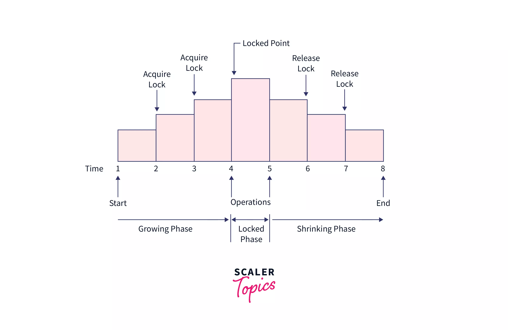
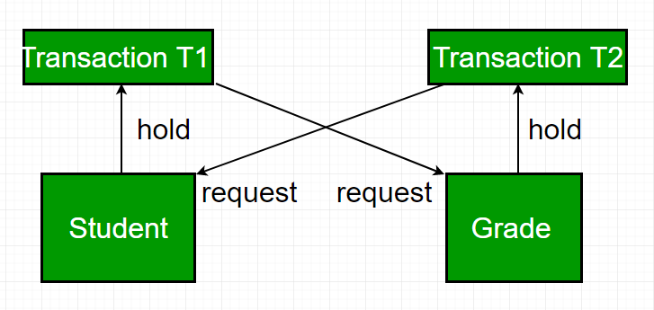

# Locking Mechanism

##  Introduction

A locking mechanism is used in a database to control simultaneous access to data by multiple transactions.

When multiple users try to access or modify the same data at the same time, problems can occur, such as incorrect updates or inconsistent data.

**Locking prevents conflicting operations from interfering with each other.**

### Example

Suppose a bank account has a balance of ₹10,000.

Two transactions execute simultaneously:

- Transaction T1 withdraws ₹2,000.
- Transaction T2 withdraws ₹3,000.

Both transactions read the original balance of ₹10,000.

Without proper control, the final balance might become incorrect because one transaction can overwrite the changes made by another.

Locking helps control such situations.

---

##  What is a Lock?

A lock is a mechanism that temporarily restricts access to a database resource while a transaction is using it.

A database resource can be:

- A row
- A table
- A page or block
- A database object

Locks ensure that multiple transactions do not perform conflicting operations simultaneously.

---

##  Types of Locks

There are two fundamental types of locks.

### 1. Shared Lock (S Lock)

A Shared Lock is used when a transaction wants to read data.

- Multiple transactions can acquire shared locks on the same resource.
- Other transactions can also read the locked data.
- A transaction cannot modify the data while another transaction holds a shared lock.

**Example:**

- T1 reads an account balance and acquires a shared lock.
- T2 also reads the same balance and acquires a shared lock.
- Both transactions can read simultaneously.

### 2. Exclusive Lock (X Lock)

An Exclusive Lock is used when a transaction wants to modify data.

- Only one transaction can hold an exclusive lock on a resource.
- Other transactions cannot acquire shared or exclusive locks on that resource.
- It prevents other transactions from modifying or reading the locked resource until the lock is released, depending on the database's locking rules.

**Example:**

- T1 updates an account balance and acquires an exclusive lock.
- T2 wants to update the same balance.
- T2 must wait until T1 releases its lock.


##  Locking Granularity

Locking granularity refers to the size of the database resource on which a lock is applied.

### 1. Row-Level Locking

A lock is applied to an individual row.

- Different transactions can modify different rows simultaneously.
- Provides better concurrency.
- Commonly used for frequently updated tables.

**Example:**

T1 updates account 101, while T2 updates account 102.

Both transactions can execute simultaneously because they modify different rows.

### 2. Table-Level Locking

A lock is applied to the entire table.

- Multiple rows are protected together.
- Other transactions may have to wait even if they want to access different rows.
- Can reduce concurrency.

### 3. Page-Level Locking

A lock is applied to a database page or block containing multiple rows.

- Protects multiple records together.
- Provides a balance between row-level and table-level locking.
- Used by some database systems.

### Comparison

| Locking Type | Resource Locked | Concurrency |
|---|---|---|
| Row-Level | Individual row | High |
| Page-Level | Database page | Medium |
| Table-Level | Entire table | Low |

**Note:** Different database systems implement locking granularity differently. PostgreSQL primarily uses row-level and table-level locks rather than traditional page-level data locks.

---

##  Locking Mechanisms

### 1. Pessimistic Locking

Pessimistic locking assumes that conflicts are likely to happen.

Therefore, it locks data before modifying it.

**Example:**

A transaction locks an account row before withdrawing money.

```sql
BEGIN;

SELECT *
FROM bank_accounts
WHERE account_id = 101
FOR UPDATE;

UPDATE bank_accounts
SET balance = balance - 2000
WHERE account_id = 101;

COMMIT;
```

Here:

- `FOR UPDATE` acquires a row-level lock.
- Other transactions trying to update or acquire conflicting locks on that row must wait.
- The lock is released when the transaction commits or rolls back.

### 2. Optimistic Locking

Optimistic locking assumes that conflicts are unlikely.

Instead of locking data before modifying it, the transaction checks whether the data has changed since it was read.

A version column is commonly used for this purpose.

**Example:**

Suppose the account table contains a `version` column.

```sql
UPDATE bank_accounts
SET balance = 8000,
    version = version + 1
WHERE account_id = 101
AND version = 1;
```

**Output:**

| UPDATE |
|---|
| UPDATE 1 |

If another transaction has already modified the row, its version will have changed.

The condition `version = 1` will fail.

**Output when a conflict occurs:**

```text
UPDATE 0
```

This means no row was updated.

The application can then reload the latest data and retry the operation.

### Comparison

| Pessimistic Locking | Optimistic Locking |
|---|---|
| Locks data before modification | Checks for conflicts during modification |
| Transactions may have to wait | Transactions generally do not wait for application-level locks |
| Suitable for frequent conflicts | Suitable for rare conflicts |
| Uses mechanisms like `FOR UPDATE` | Commonly uses version numbers |

---

## 6. Two-Phase Locking (2PL)

Two-Phase Locking is a concurrency control protocol that helps ensure conflict serializability.

It divides a transaction into two phases.

### Phase 1: Growing Phase

- A transaction can acquire new locks.
- It cannot release any lock.

### Phase 2: Shrinking Phase

- A transaction can release locks.
- It cannot acquire any new locks.

### Diagram



### Example

```text
Transaction T1:

1. Acquire lock on Account A
2. Acquire lock on Account B
3. Read Account A
4. Update Account B
5. Release lock on Account A
6. Release lock on Account B
7. Commit
```

After releasing the first lock, T1 cannot acquire any new locks.

### Types of Two-Phase Locking

**1. Basic 2PL**

Follows the growing and shrinking phases.

It guarantees conflict serializability but may cause cascading rollbacks.

**2. Strict 2PL**

- Holds all exclusive locks until the transaction commits or rolls back.
- Prevents other transactions from reading uncommitted changes made by the transaction.
- Helps prevent cascading rollbacks.

**3. Rigorous 2PL**

- Holds both shared and exclusive locks until the transaction commits or rolls back.
- Provides stricter control than Strict 2PL.

---

##  Deadlock

A deadlock occurs when two or more transactions wait indefinitely for resources locked by each other.

### Example

Consider two accounts: A and B.

```text
Transaction T1:
1. Locks Account A
2. Requests Account B

Transaction T2:
1. Locks Account B
2. Requests Account A
```

Now:

- T1 waits for T2 to release B.
- T2 waits for T1 to release A.

Neither transaction can proceed.

### Deadlock Diagram
Here,
- T1 locks Resource "Student" and needs Resource "Grade"
- T2 locks Resource "Grade" and needs Resource "Student"
- T1 waits for T2, T2 waits for T1, hence resulting in a deadlock



### Deadlock Handling

**1. Deadlock Detection**

The database detects circular waiting using a wait-for graph.

**2. Deadlock Resolution**

The database selects one transaction as a victim and rolls it back to release its locks.

**3. Deadlock Prevention**

Transactions can acquire locks in a consistent order to reduce the possibility of deadlocks.

**Example:**

Always lock Account A before Account B, rather than allowing different transactions to lock them in different orders.

**4. Deadlock Timeout**

The database can terminate a transaction if it waits for a lock longer than the configured timeout.

---

##  Lock Escalation

Lock escalation occurs when a database replaces multiple smaller locks with a larger lock.

**Example:**

A transaction acquires locks on thousands of individual rows.

Instead of maintaining all those locks, a database may replace them with a table-level lock.

**Advantages:**
- Reduces the number of locks maintained.
- Reduces lock management overhead.

**Disadvantage:**
- Can reduce concurrency because a larger resource is locked.

**Note:** Lock escalation is database-specific. PostgreSQL does not use traditional automatic row-to-table lock escalation.

---

##  SQL Locking in PostgreSQL

PostgreSQL provides several locking options.

### 1. SELECT FOR UPDATE

Locks selected rows so other transactions cannot acquire conflicting row locks or modify those rows until the transaction ends.

```sql
BEGIN;

SELECT *
FROM bank_accounts
WHERE account_id = 101
FOR UPDATE;

COMMIT;
```

### 2. SELECT FOR SHARE

Acquires a shared row lock.

Multiple transactions can acquire this lock simultaneously, but conflicting updates and deletes must wait.

```sql
BEGIN;

SELECT *
FROM bank_accounts
WHERE account_id = 101
FOR SHARE;

COMMIT;
```

### 3. NOWAIT

Instead of waiting for a conflicting lock, the transaction immediately receives an error if the lock cannot be acquired.

```sql
SELECT *
FROM bank_accounts
WHERE account_id = 101
FOR UPDATE NOWAIT;
```

**Output when the row is already locked:**

```text
ERROR: could not obtain lock on row
```

### 4. SKIP LOCKED

Skips rows that are already locked instead of waiting for them.

```sql
SELECT *
FROM bank_accounts
WHERE account_id = 101
FOR UPDATE SKIP LOCKED;
```

If the row is locked by another transaction, it will not be returned.

**Common Use Case:** Job queues, where multiple workers process different available jobs without waiting for each other.

### 5. Explicit Table Locking

PostgreSQL also supports explicitly locking an entire table.

```sql
BEGIN;

LOCK TABLE bank_accounts IN EXCLUSIVE MODE;

COMMIT;
```

Different table lock modes provide different levels of restriction.

---

##  Problems Related to Locking

### 1. Blocking

Blocking occurs when one transaction must wait because another transaction holds a conflicting lock.

### 2. Deadlock

Occurs when transactions wait for each other in a circular manner.

### 3. Starvation

Starvation occurs when a transaction repeatedly fails to acquire the required lock because other transactions keep getting access.

### 4. Lock Contention

Lock contention occurs when multiple transactions frequently compete for the same database resource.

It can reduce performance and increase waiting time.

---
