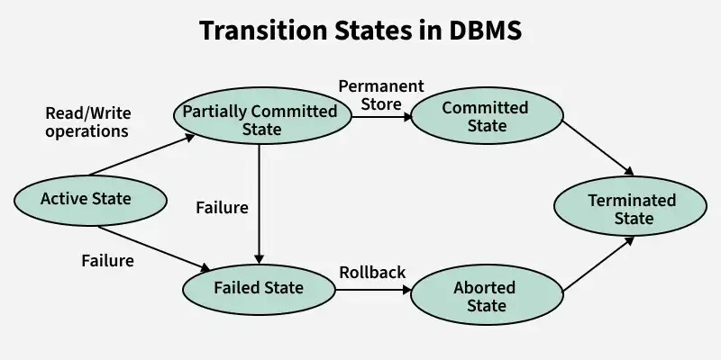

# Transactions

##  What is a Transaction?

A **transaction** is a group of one or more SQL operations treated as a single unit of work.

Either all operations are successfully completed, or none of them are applied.

Transactions follow the ACID properties

**Example:** Suppose we want to increase the salaries of employees. If an error occurs during the transaction, all changes should be rolled back.

### Sample Data Used Throughout

**employees**

| emp_id | emp_name | department | salary |
|---:|---|---|---:|
| 1 | Rahul | IT | 50000 |
| 2 | Priya | HR | 40000 |
| 3 | Aman | IT | 60000 |
| 4 | Neha | Finance | 55000 |
| 5 | Karan | HR | 45000 |


## Transaction Commands

| Command | Description |
|---|---|
| BEGIN / START TRANSACTION | Starts a new transaction. |
| COMMIT | Permanently saves all changes made in the transaction. |
| ROLLBACK | Undoes all uncommitted changes made in the transaction. |
| SAVEPOINT | Creates a checkpoint within a transaction. |
| ROLLBACK TO SAVEPOINT | Undoes changes made after a particular savepoint. |

##  BEGIN and COMMIT

`BEGIN` starts a transaction, and `COMMIT` permanently saves all changes.

**Example:**

```sql
BEGIN;

UPDATE employees
SET salary = salary + 5000
WHERE emp_id = 1;

UPDATE employees
SET salary = salary + 5000
WHERE emp_id = 2;

COMMIT;
```

**Output (Updated Rows):**

| emp_id | emp_name | salary |
|---:|---|---:|
| 1 | Rahul | 55000 |
| 2 | Priya | 45000 |

Both updates are permanently saved after `COMMIT`.

##  ROLLBACK

`ROLLBACK` cancels all changes made in the current transaction that have not yet been committed.

**Example:**

```sql
BEGIN;

UPDATE employees
SET salary = salary + 5000
WHERE emp_id = 1;

ROLLBACK;
```

**Output (After ROLLBACK):**

| emp_id | emp_name | salary |
|---:|---|---:|
| 1 | Rahul | 50000 |

The salary remains unchanged because the update was rolled back.

## SAVEPOINT

A `SAVEPOINT` creates a checkpoint inside a transaction.

We can roll back to a particular savepoint without cancelling the entire transaction.

**Example:**

```sql
BEGIN;

UPDATE employees
SET salary = salary + 5000
WHERE emp_id = 1;

SAVEPOINT sp1;

UPDATE employees
SET salary = salary + 5000
WHERE emp_id = 2;

ROLLBACK TO SAVEPOINT sp1;

COMMIT;
```

**Output (Final Data):**

| emp_id | emp_name | salary |
|---:|---|---:|
| 1 | Rahul | 55000 |
| 2 | Priya | 40000 |

**Explanation:**

1. Rahul's salary is increased by 5000.
2. A savepoint `sp1` is created.
3. Priya's salary is increased by 5000.
4. `ROLLBACK TO SAVEPOINT sp1` cancels Priya's update.
5. `COMMIT` permanently saves Rahul's update.

##  Transaction States

A transaction passes through different states during its execution.

| State | Description |
|---|---|
| Active | The transaction is currently executing. |
| Partially Committed | All operations have executed, but changes are not yet permanently committed. |
| Committed | The transaction has completed successfully. |
| Failed | The transaction cannot continue because of an error. |
| Aborted | All changes made by the failed transaction have been rolled back. |
| Terminated | The transaction has finished and left the system. |




## Auto-Commit Mode

In auto-commit mode, each SQL statement is automatically committed after successful execution.

This means we do not need to explicitly execute `COMMIT` for every statement.

**Example:**

```sql
UPDATE employees
SET salary = salary + 5000
WHERE emp_id = 1;
```

**Output (Updated Row):**

| emp_id | emp_name | salary |
|---:|---|---:|
| 1 | Rahul | 55000 |

The update is automatically saved after successful execution.

To perform multiple statements as a single transaction, we can explicitly use `BEGIN` and `COMMIT`.

- Auto-commit behavior depends on the database system and client configuration.
