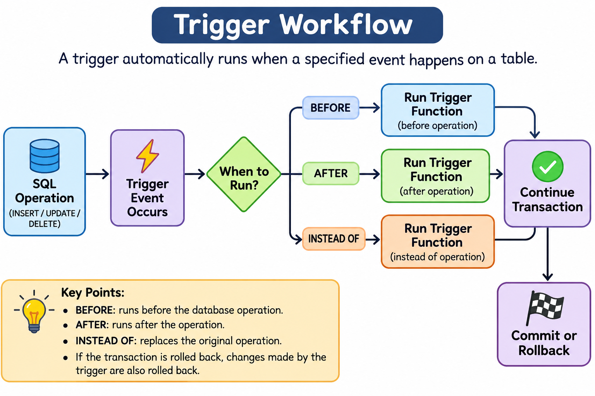

# Triggers

##  Introduction

A Trigger is a database object that automatically executes a specified function when a particular event occurs on a table or view.

Triggers are commonly used to:

- Maintain audit logs.
- Track changes in records.
- Automatically update related data.
- Validate data before insertion or modification.
- Maintain data consistency.

**Example:**

Whenever an employee's salary is updated, we may want to automatically store the old and new salaries in an audit table.

Instead of writing this logic in every application, we can create a trigger that executes automatically.

---

##  How Triggers Work

A trigger is associated with a database table or view.

When a specified event occurs, the database automatically executes the trigger function.

### Trigger Execution Flow



**Important:** A trigger does not need to be called manually. The database executes it automatically when its associated event occurs.

---

##  Sample Dataset

We will use the following employee table throughout this paper.

### employees

| emp_id | emp_name | department | salary |
|---:|---|---|---:|
| 101 | Alice | IT | 50000 |
| 102 | Bob | HR | 40000 |
| 103 | Charlie | IT | 60000 |

### SQL

```sql
CREATE TABLE employees (
    emp_id INT PRIMARY KEY,
    emp_name VARCHAR(50),
    department VARCHAR(50),
    salary INT
);

INSERT INTO employees VALUES
(101, 'Alice', 'IT', 50000),
(102, 'Bob', 'HR', 40000),
(103, 'Charlie', 'IT', 60000);
```

We will also create an audit table to store salary changes.

### salary_audit

```sql
CREATE TABLE salary_audit (
    audit_id SERIAL PRIMARY KEY,
    emp_id INT,
    old_salary INT,
    new_salary INT,
    changed_at TIMESTAMP DEFAULT CURRENT_TIMESTAMP
);
```

---

##  Types of Triggers

Triggers can be classified based on their execution timing and the level at which they execute.

###  Based on Execution Timing

#### A. BEFORE Trigger

A BEFORE trigger executes before the actual database operation.

Common uses:

- Validating input data.
- Modifying values before insertion.
- Preventing invalid operations.

**Example:** Prevent inserting an employee with a negative salary.

#### B. AFTER Trigger

An AFTER trigger executes after the database operation has been performed.

Common uses:

- Maintaining audit records.
- Updating related tables.
- Recording changes.

**Example:** Store salary changes in the salary_audit table after an employee's salary is updated.

#### C. INSTEAD OF Trigger

An INSTEAD OF trigger executes instead of the original database operation.

It is commonly used with views to control how INSERT, UPDATE, or DELETE operations are handled.

**Example:** When a user inserts data into a view, an INSTEAD OF trigger can insert the data into the underlying tables.

**Note:** PostgreSQL supports INSTEAD OF triggers on views, not ordinary tables.

### Comparison

| Trigger Type | Execution |
|---|---|
| BEFORE | Before the database operation |
| AFTER | After the database operation |
| INSTEAD OF | Instead of the database operation |

---

##  Based on Trigger Level

### 1. Row-Level Trigger

A Row-Level Trigger executes once for every affected row.

It is created using:

```sql
FOR EACH ROW
```

**Example:**

If an UPDATE statement modifies three employee records, the trigger executes three times.

### 2. Statement-Level Trigger

A Statement-Level Trigger executes once for the entire SQL statement, regardless of how many rows are affected.

It is created using:

```sql
FOR EACH STATEMENT
```

**Example:**

If an UPDATE statement modifies three employee records, the trigger executes only once.

### Comparison

| Row-Level Trigger | Statement-Level Trigger |
|---|---|
| Executes once per affected row | Executes once per SQL statement |
| Uses `FOR EACH ROW` | Uses `FOR EACH STATEMENT` |
| Can access OLD and NEW row values | Cannot access individual OLD and NEW row values |
| Useful for row-specific operations | Useful for statement-level logging |

---

##  Trigger Events

A trigger can execute when a particular database operation occurs.

The main events are:

### 1. INSERT

Executes when a new record is inserted.

```sql
CREATE TRIGGER trigger_name
AFTER INSERT ON employees
FOR EACH ROW
EXECUTE FUNCTION function_name();
```

### 2. UPDATE

Executes when an existing record is modified.

```sql
CREATE TRIGGER trigger_name
AFTER UPDATE ON employees
FOR EACH ROW
EXECUTE FUNCTION function_name();
```

### 3. DELETE

Executes when a record is deleted.

```sql
CREATE TRIGGER trigger_name
AFTER DELETE ON employees
FOR EACH ROW
EXECUTE FUNCTION function_name();
```

### 4. TRUNCATE

Executes when all records are removed using the TRUNCATE command.

```sql
CREATE TRIGGER trigger_name
AFTER TRUNCATE ON employees
FOR EACH STATEMENT
EXECUTE FUNCTION function_name();
```

**Note:** PostgreSQL supports triggers for INSERT, UPDATE, DELETE, and TRUNCATE events.

---

##  OLD and NEW Keywords

OLD and NEW are special records available inside row-level trigger functions.

They provide access to the values of a row before and after a database operation.

### OLD

Contains the existing row values before the operation.

### NEW

Contains the new row values.

| Operation | OLD | NEW |
|---|---|---|
| INSERT | Not available | New inserted row |
| UPDATE | Previous row | Updated row |
| DELETE | Deleted row | Not available |

**Example:**

Suppose Alice's salary changes from ₹50,000 to ₹60,000.

- `OLD.salary` = 50000
- `NEW.salary` = 60000

**Important:** OLD and NEW are available as row records in row-level triggers. Statement-level triggers use transition tables when row-level change data is required in PostgreSQL.

---

##  Creating Triggers in PostgreSQL

In PostgreSQL, creating a trigger generally involves two steps:

1. Create a trigger function.
2. Create a trigger that executes that function.

###  Create a Trigger Function

A trigger function contains the logic that should execute when the trigger fires.

**Example:**

Automatically record salary changes.

```sql
CREATE OR REPLACE FUNCTION log_salary_changes()
RETURNS TRIGGER AS $$
BEGIN
    INSERT INTO salary_audit (
        emp_id,
        old_salary,
        new_salary
    )
    VALUES (
        OLD.emp_id,
        OLD.salary,
        NEW.salary
    );

    RETURN NEW;
END;
$$ LANGUAGE plpgsql;
```

**Explanation:**

- `RETURNS TRIGGER`: Indicates that this function is a trigger function.
- `OLD.salary`: Stores the previous salary.
- `NEW.salary`: Stores the updated salary.
- `INSERT INTO salary_audit`: Records the salary change.
- `RETURN NEW`: Returns the updated row.

###  Create the Trigger

```sql
CREATE TRIGGER salary_update_trigger
AFTER UPDATE ON employees
FOR EACH ROW
EXECUTE FUNCTION log_salary_changes();
```

**Explanation:**

- `AFTER UPDATE`: Executes after an UPDATE operation.
- `ON employees`: Associates the trigger with the employees table.
- `FOR EACH ROW`: Executes once for every updated row.
- `EXECUTE FUNCTION`: Specifies the function to execute.

###  Test the Trigger

```sql
UPDATE employees
SET salary = 60000
WHERE emp_id = 101;
```

**employees Output:**

| emp_id | emp_name | department | salary |
|---:|---|---|---:|
| 101 | Alice | IT | 60000 |
| 102 | Bob | HR | 40000 |
| 103 | Charlie | IT | 60000 |

**salary_audit Output:**

| audit_id | emp_id | old_salary | new_salary |
|---:|---:|---:|---:|
| 1 | 101 | 50000 | 60000 |

The audit record is inserted automatically without explicitly writing an INSERT statement in the application.

---

##  Practical Trigger Examples

###  BEFORE INSERT Trigger

Prevent inserting employees with negative salaries.

**Trigger Function:**

```sql
CREATE OR REPLACE FUNCTION validate_salary()
RETURNS TRIGGER AS $$
BEGIN
    IF NEW.salary < 0 THEN
        RAISE EXCEPTION 'Salary cannot be negative';
    END IF;

    RETURN NEW;
END;
$$ LANGUAGE plpgsql;
```

**Create Trigger:**

```sql
CREATE TRIGGER salary_validation_trigger
BEFORE INSERT ON employees
FOR EACH ROW
EXECUTE FUNCTION validate_salary();
```

**Test:**

```sql
INSERT INTO employees
VALUES (104, 'David', 'IT', -5000);
```

**Output:**

```text
ERROR: Salary cannot be negative
```

The record is not inserted.

###  AFTER DELETE Trigger

Automatically store deleted employee details in an audit table.

**Create Audit Table:**

```sql
CREATE TABLE deleted_employees (
    emp_id INT,
    emp_name VARCHAR(50),
    department VARCHAR(50),
    salary INT,
    deleted_at TIMESTAMP DEFAULT CURRENT_TIMESTAMP
);
```

**Trigger Function:**

```sql
CREATE OR REPLACE FUNCTION log_deleted_employee()
RETURNS TRIGGER AS $$
BEGIN
    INSERT INTO deleted_employees (
        emp_id,
        emp_name,
        department,
        salary
    )
    VALUES (
        OLD.emp_id,
        OLD.emp_name,
        OLD.department,
        OLD.salary
    );

    RETURN OLD;
END;
$$ LANGUAGE plpgsql;
```

**Create Trigger:**

```sql
CREATE TRIGGER employee_delete_trigger
AFTER DELETE ON employees
FOR EACH ROW
EXECUTE FUNCTION log_deleted_employee();
```

**Test:**

```sql
DELETE FROM employees
WHERE emp_id = 102;
```

**deleted_employees Output:**

| emp_id | emp_name | department | salary |
|---:|---|---|---:|
| 102 | Bob | HR | 40000 |

The deleted employee's information is automatically stored in the audit table.

---

##  Important Trigger Concepts

###  WHEN Condition

The WHEN condition specifies when a trigger should execute.

It helps avoid executing a trigger unnecessarily.

**Example:**

Only execute the salary audit trigger when the salary actually changes.

```sql
CREATE TRIGGER salary_update_trigger
AFTER UPDATE ON employees
FOR EACH ROW
WHEN (OLD.salary IS DISTINCT FROM NEW.salary)
EXECUTE FUNCTION log_salary_changes();
```

`IS DISTINCT FROM` safely compares values, including NULL values.

###  UPDATE OF Column

A trigger can be restricted to updates of a particular column.

**Example:**

```sql
CREATE TRIGGER salary_update_trigger
AFTER UPDATE OF salary ON employees
FOR EACH ROW
EXECUTE FUNCTION log_salary_changes();
```

This trigger fires only when the salary column is included in the UPDATE statement.

###  Transition Tables

Transition tables allow statement-level triggers to access the set of rows affected by an operation.

PostgreSQL supports:

- `OLD TABLE`: Contains the old versions of affected rows.
- `NEW TABLE`: Contains the new versions of affected rows.

They are useful when a trigger needs to process multiple affected rows together.

**Example:**

```sql
CREATE TRIGGER employee_update_trigger
AFTER UPDATE ON employees
REFERENCING OLD TABLE AS old_rows
            NEW TABLE AS new_rows
FOR EACH STATEMENT
EXECUTE FUNCTION function_name();
```

The trigger function can access these transition tables using SQL queries.

**Note:** Transition tables have restrictions depending on the trigger event and cannot be used with every trigger configuration.

###  Trigger Execution Order

When multiple triggers are defined for the same event and timing, PostgreSQL executes triggers of the same kind in alphabetical order by trigger name.

For example:

```text
audit_trigger
salary_trigger
validation_trigger
```

They execute in alphabetical order when their event and timing match.

###  Cascading Triggers

A trigger may perform an operation on another table that activates another trigger.

This creates a chain of trigger executions.

**Example:**

```text
UPDATE employees
       |
       v
Employee Trigger
       |
       v
UPDATE department_summary
       |
       v
Department Trigger
```

Trigger chains should be designed carefully to avoid unexpected recursive behavior.

---

##  Managing Triggers

### Disable a Trigger

```sql
ALTER TABLE employees
DISABLE TRIGGER salary_update_trigger;
```

### Enable a Trigger

```sql
ALTER TABLE employees
ENABLE TRIGGER salary_update_trigger;
```

### Drop a Trigger

```sql
DROP TRIGGER salary_update_trigger
ON employees;
```

### View Triggers

PostgreSQL provides information about triggers through the `information_schema.triggers` view.

```sql
SELECT
    trigger_name,
    event_manipulation,
    action_timing,
    event_object_table
FROM information_schema.triggers
WHERE event_object_table = 'employees';
```

---

##  Advantages of Triggers

1. Automate database operations.
2. Maintain audit logs automatically.
3. Help enforce business rules.
4. Maintain consistency across related tables.
5. Reduce repetitive application-side code.
6. Execute logic automatically whenever specified events occur.

---

##  Disadvantages and Limitations

1. Triggers execute automatically, which can make debugging difficult.
2. Complex triggers can reduce database performance.
3. Cascading triggers can create unexpected behavior.
4. Business logic inside triggers may be difficult to maintain.
5. Trigger execution can increase transaction execution time.
6. Hidden database operations can make application behavior harder to understand.

---

##  Triggers vs Stored Procedures

| Triggers | Stored Procedures |
|---|---|
| Execute automatically when an event occurs | Called explicitly by an application or SQL command |
| Associated with tables or views | Stored as database routines |
| Commonly used for auditing and automatic validation | Used for reusable database operations |
| Cannot be directly called like ordinary procedures | Can be explicitly executed |

**Important:** In PostgreSQL, triggers execute trigger functions, which are different from stored procedures.

---
